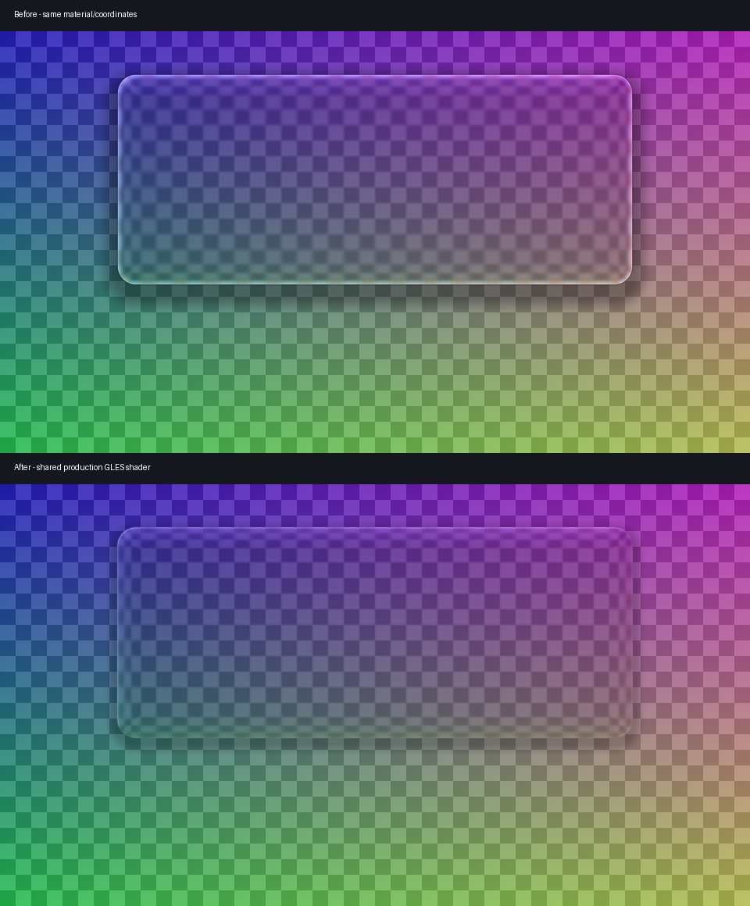

# Qimgui

面向 Android ARM64 的 C++17 悬浮界面框架，基于 **Dear ImGui 1.93.0**。
原生程序名仍为 `AImGui`，通过 SurfaceFlinger 创建窗口，核心界面无需 APK 或 Activity。

- Vulkan 优先，初始化失败回退 OpenGL ES 3；两条路径均使用垂直同步。
- 液体玻璃、辉光、灵动岛／卡片／窗口形态、弹簧动画、涟漪和可折叠列表。
- 系统中文字体、触感反馈、设置持久化，以及可选 Live2D Cubism 集成。
- 原生 Material Design 3 组件库：按钮、表单、选择器、导航、列表、面板与反馈组件。
- 控件页提供明暗主题示例；组件直接由 ImGui 绘制，不需要 APK、DEX 或 WebView。
- ImGui 核心、公共头文件和渲染后端一起从固定版本源码编译，避免 `.a` 与头文件不匹配。

这是持续绘制、由 VSync 控制提交节奏的界面，**尚未实现静止时完全停止绘制**。

## 构建

已验证的工具链：Android NDK **r29 / 29.0.14206865**、CMake 3.18+。

```bash
export ANDROID_NDK_HOME=/path/to/android-ndk-r29
./build.sh
# 输出：libs/arm64-v8a/AImGui
```

ImGui 源码已随仓库提供，普通构建不需要下载依赖。默认关闭 Live2D，相关 SDK 和模型按
[Live2D 文档](docs/LIVE2D.md)准备。开启时执行 `./build.sh -DAIMGUI_LIVE2D=ON`。

## 运行

程序创建系统级 Surface 并读取触摸设备，需要 root 或等价的系统权限。
部署本次构建的 ELF：

```bash
adb push libs/arm64-v8a/AImGui /data/local/tmp/AImGui
adb shell chmod 755 /data/local/tmp/AImGui
adb shell su -c /data/local/tmp/AImGui
```

音量键可收起／展开窗口。“控件”页是 MD3 组件展示。已移除 Java 输入法与系统剪贴板桥接，
文字输入通过原生键盘事件完成；目前需要外接键盘，不会自动唤起 Android 软键盘。
MD3 控件支持 ImGui 的键盘导航，按 Tab 切换焦点。

## 项目结构

| 路径 | 职责 |
| --- | --- |
| `config/aimgui_imconfig.h` | 所有目标共用的 ImGui 编译配置 |
| `third_party/imgui/` | 固定的上游源码、MIT 许可证与 SHA-256 清单 |
| `jni/src/main.cpp` | 生命周期、输入、渲染和配置保存 |
| `jni/src/platform/` | SurfaceFlinger 窗口与触摸设备接入 |
| `jni/src/core/` | 渲染后端、字体、玻璃、辉光及设备输入 |
| `jni/src/core/shaders/` | 着色器源码；玻璃材质逻辑由 GLES／Vulkan 共用 |
| `jni/src/ui/` | 窗口外壳、页面、弹窗、动画和交互组件 |
| `jni/include/ui/md3*.h`、`jni/src/ui/md3/` | 原生 MD3 公共接口与实现 |
| `jni/src/live2d/` | 可选模型、纹理与音频集成 |
| `scripts/` | 构建、上游更新、着色器生成与校验 |
| `tests/` | 主机回归检查与软件渲染检查 |
| `release/` | 当前构建产物获取说明；可执行文件由 CI 生成 |

添加页面主要修改 `jni/include/ui/main_ui.h` 与 `jni/src/ui/main_ui.cpp`。
[Android 接入记录](docs/ANDROID_NOTES.md)解释了旋转、窗口销毁顺序与录屏兼容性等历史问题。

MD3 接入与组件清单见 [docs/MD3.md](docs/MD3.md)，网页参考与截图复现见 [docs/MD3_REFERENCE.md](docs/MD3_REFERENCE.md)。

## 液体玻璃

GLES 与 Vulkan 共用 `glass_common.glsl`，减少两套材质实现发生偏差的机会。

- 由距离场合成圆角与连接区域，按像素导数平滑边缘。
- 中央区域保持清晰，折射和有限色散集中在边缘。
- 一次 9 点模糊加边缘色散／反射，最重分支最多 12 次纹理读取；旧实现最多 44 次。
  这是着色器读取次数对比，**不代表真机帧率提高相同比例**。
- 统一上原点坐标；屏幕纹理和 OpenGL framebuffer 副本分别处理采样方向。
- 区分硬连接和柔性连接，避免同一面板的接缝鼓包。

修改材质后重新生成两套后端资源：

```bash
scripts/compile_glass_shaders.sh
scripts/compile_glass_shaders.sh --check
```

使用 NDK r29 的 `glslc` 保持生成结果可复现。生成的头文件随仓库提交，正常构建不需要编译着色器。



图中使用相同的测试背景、坐标和材质参数，展示着色器变化；不是 Android 真机截图。

## 升级 ImGui

当前来源：[`v1.93.0`](https://github.com/ocornut/imgui/releases/tag/v1.93.0)，
提交 `c1aaac65e896a45f81f47a4d68f9959e0f86c859`。

```bash
python3 scripts/update_imgui.py v1.93.0
python3 scripts/verify_sources.py
./build.sh
```

更新脚本同步核心、头文件、GL／VK 后端和来源清单。`prepare-imgui-update` 工作流会生成
经过构建检查的补丁供审阅，不会强制覆盖远端分支。

1.93 适配包含 `CmdLists.Size`、Vulkan sampled-image／sampler 描述符池，以及
文字描边对图集中圆角和线条区域的排除。不要只修改版本宏。

## 验证

```bash
tests/run_host_checks.sh
python3 -m pip install -r tests/requirements.txt
python3 tests/render_glass.py --output build/glass-preview.png
```

主机检查使用 ASan／UBSan，覆盖图集形状、文字描边、纹理延迟上传、回调和索引。
GLES 检查使用 Mesa／EGL
渲染实际着色器，验证坐标、边缘覆盖、framebuffer 方向与屏幕边界。

CI 构建 ARM64 ELF，并校验上游源码与生成着色器。Android 真机的触摸、
屏幕镜像、外接键盘、旋转、GL／VK 视觉一致性和功耗仍需要设备验证；Live2D 需要单独提供 SDK。

## 致谢与许可

- Qimgui：Apache-2.0，见 [LICENSE](LICENSE)。
- [Dear ImGui](https://github.com/ocornut/imgui)：Omar Cornut，MIT；许可证随上游源码保留。
- [AndroidSurfaceImgui-Enhanced](https://github.com/AFan4724/AndroidSurfaceImgui-Enhanced)：窗口／触摸接入来源。
- Vulkan wrapper：Google NDK samples，Apache-2.0。
- Live2D Cubism 的 SDK 和模型遵循其各自许可，不包含在本仓库中。
