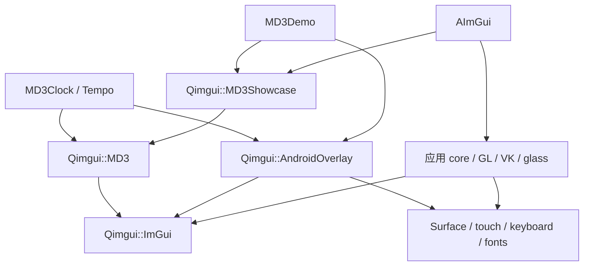

# 代码结构与开发入口

项目分为可移植组件、可选 Android 宿主和应用三层。应用持有业务状态，组件负责交互和绘制；平台资源由应用选择的宿主管理。

## 构建入口

| CMake 源目录 | 产物 | 使用场景 |
| --- | --- | --- |
| 仓库根目录 | `AImGui`、`MD3Demo`，及它们使用的库 | Android ARM64 应用，通常由 `build.sh` 配置 NDK |
| `libraries/md3/` | `Qimgui::MD3`、`Qimgui::ImGui`，可选图库／Android 宿主及安装包 | 独立构建 SDK，或被现有 ImGui 工程作为子目录消费 |
| `examples/md3_clock/` | `MD3Clock` | 只通过 `find_package` 消费已安装的组件和 Android 宿主 |
| `examples/md3_consumer/` | `md3_consumer` | 无窗口接入检查，可使用源码子目录或安装包 |

根工程需要 NDK r29、CMake 和 Python 3。组件 SDK 的默认可移植构建只需要 C++17 编译器及 CMake；开启 Android 宿主后才要求 NDK 和用于生成字体资源的 Python。不要把桌面编译的静态库链接进 Android，或在同一程序中重复编译不同配置的 ImGui 核心。

SDK 选项在 `libraries/md3/CMakeLists.txt` 定义：

| 选项 | 默认 | 作用 |
| --- | --- | --- |
| `QIMGUI_MD3_BUILD_SHOWCASE` | `ON` | 构建可选 `Qimgui::MD3Showcase` 图库 |
| `QIMGUI_MD3_BUILD_ANDROID_OVERLAY` | `OFF` | 构建 `Qimgui::AndroidOverlay`，要求 Android toolchain |
| `QIMGUI_MD3_INSTALL` | `ON` | 安装头文件、静态库、CMake 配置和许可 |

根 Android 工程启用图库和共享宿主。`MD3Clock` 单独构建，不依赖根工程的应用 target。详细命令见 [SDK 接入](MD3_FRAMEWORK.md) 和 [Tempo 示例](MD3_CLOCK.md)。

## 依赖方向

`Qimgui::MD3` 没有 Android、Surface、传感器或渲染后端引用。`Qimgui::MD3Showcase` 只组合公共组件；图库不进入核心静态库。平台宿主链接同一份固定版本 ImGui，应用可选择它，也可接入自己的窗口、输入和渲染后端。

## 目录边界

| 路径 | 放置内容 |
| --- | --- |
| `jni/include/qimgui/` | 对外统一入口：组件、可选图库、可选 Android 宿主 |
| `jni/include/ui/md3*.h` | 组件级公共声明；保留旧接入方式 |
| `jni/src/ui/md3/` | 组件实现、内部主题／交互工具，以及独立构建的图库源文件 |
| `libraries/md3/` | SDK target、安装和 package 配置 |
| `libraries/android_overlay/` | Android 宿主 target 与运行依赖，不放页面 |
| `jni/src/runtime/` | `RunOverlay` 帧循环与 `SimpleRenderer` GLES 实现 |
| `jni/src/demo/` | `MD3Demo` 的页面、状态适配和调用共享宿主的入口 |
| `examples/md3_clock/src/` | `main` 接入宿主，`app` 管理窗口／导航，`pages` 组合组件，`model` 管理业务状态 |
| `jni/src/ui/ui.cpp`、`jni/src/ui/main_ui.cpp` | `AImGui` 外壳、导航、页面与对话框 |
| `jni/src/core/` | 应用渲染器、玻璃、字体、输入辅助、配置、诊断等能力 |
| `jni/src/platform/` | Surface 私有接口适配、显示信息解析和触摸接入 |
| `kernel/src/` | 内核模块入口、DRM 显示接入、input handler、帧循环、窗口与触摸判定 |
| `kernel/compat/`、`kernel/raster/`、`kernel/ui/` | 内核侧 C++ 运行时与 libm 子集、定点光栅器、内核侧 ImGui 页面 |
| `third_party/` | 上游代码、预设数据、许可证和固定版本记录 |
| `scripts/` | 来源同步、字体／着色器／形状数据生成、设备诊断 |
| `tests/` | 按功能命名的主机回归程序、平台桩和软件渲染工具 |

`build/`、`libs/` 是忽略的生成目录。`build/` 中的截图、临时 SDK、诊断包和对照数据用于验证与交付，不作为组件源码提交。

## 修改功能时从哪里开始

- 新组件：公共声明放在 `jni/include/ui/`，实现放在 `jni/src/ui/md3/`，通过 `<qimgui/md3.hpp>` 暴露；图库另外组合它，业务状态由调用方传入。
- 新应用：参考 `examples/md3_clock/`，保持入口、布局、页面、业务状态分离；通过 SDK targets 链接，不复制组件或平台实现。
- 组件测试页：修改图库或 `jni/src/demo/md3_demo.cpp`，不要把 Android 初始化放进页面代码。
- 主窗口功能：修改 `jni/include/ui/main_ui.h`、`jni/src/ui/main_ui.cpp` 及需要的状态／配置；玻璃实现留在 `core`。
- Android 生命周期、字体、录屏适配：优先检查共享 `RunOverlay` 和平台适配。`MD3Demo`、`MD3Clock` 使用同一循环，避免只修复其中一个入口。
- 上游或生成数据：使用现有脚本更新并校验来源记录；保留相应许可。形状数据再生见 [MaterialShapes](MD3_SHAPES.md)。
- 内核态：组件和 ImGui 不在 `kernel/` 下复制，改动仍回到 `jni/src/ui/md3/`；`kernel/` 只放内核适配、显示、输入和光栅化。浮点只能出现在 `kernel_neon_begin()` 区间内，见 [内核态移植](KERNEL_PORT.md)。

## 按改动选择验证

主机脚本使用 ASan／UBSan；CMake 包消费测试另外验证导出依赖。所有命令从仓库根目录执行。

| 改动范围 | 验证入口 |
| --- | --- |
| 基础组件、主题、布局和选择器 | `tests/run_md3_checks.sh` |
| Expressive 控件与动画 | `tests/run_md3_expressive_checks.sh` |
| MaterialShapes 数据及绘制 | `tests/run_md3_shapes_checks.sh`；生成器校验见形状文档 |
| SDK target、安装和导出 | `tests/run_md3_package_checks.sh`，另用 NDK 构建安装后的 `MD3Clock` |
| 图库与独立组件窗口 | `tests/run_md3_demo_checks.sh` |
| 主窗口及持久化 | `tests/run_md3_main_checks.sh`、`tests/run_config_checks.sh` |
| Tempo 布局和业务状态 | `tests/run_md3_clock_checks.sh` |
| Android 宿主帧循环 | `tests/run_overlay_runtime_checks.sh`（真实循环、模拟平台服务） |
| Surface 创建／录屏镜像 | `tests/run_surface_checks.sh`、`tests/run_mirror_checks.sh`、`tests/run_display_dump_checks.sh`、`tests/run_recording_mirror_checks.sh` |
| 背景采集生命周期 | `tests/run_screen_mirror_checks.sh` |
| 传感器、触摸与崩溃诊断 | `tests/run_sensor_checks.sh`、`tests/run_touch_checks.sh`、`tests/run_crash_checks.sh`；传感器检查需要 NDK 头文件 |
| ImGui 集成与键盘输入 | `tests/run_host_checks.sh` |
| 内核态移植（数学、分配器、光栅器、输入判定、整帧渲染） | `tests/run_kernel_checks.sh`；真机范围见 [内核态移植](KERNEL_PORT.md) |
| 上游同步与玻璃着色器 | `python3 scripts/verify_sources.py`、`scripts/compile_glass_shaders.sh --check`、`python3 tests/render_glass.py` |

原生截图通过对应测试程序的 `--capture` 导出绘制数据，再使用 `tests/render_md3.py`；主界面玻璃预览使用 `tests/render_md3_main.py`。软件渲染依赖在 `tests/requirements.txt`，中文预览需要主机字体。CI 的执行次序与上传产物见 [build.yml](../.github/workflows/build.yml)。

主机模拟能检查调用、参数和资源释放，但不能证明某个 ROM 的私有接口、触摸转发、录屏画面或功耗表现。Android 17 的启动曾得到设备确认；新 SDK 录屏镜像修正仍待保存视频确认。当前证据与排查方法见 [Android 接入记录](ANDROID_NOTES.md)。
