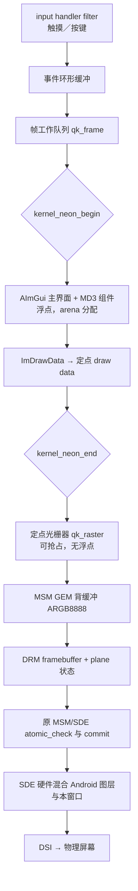

# 内核态移植

把 Qimgui 的绘制、输入和显示全部搬进内核模块：没有用户态进程，不创建 Android Surface，不经过 SurfaceFlinger。
界面由内核 CPU 光栅化到 MSM GEM 内存，经 DRM plane 交给原 MSM/SDE 驱动混合输出。

**应用层源码没有改动。** `third_party/imgui/`、`jni/src/ui/md3/` 以及 `AImGui` 主界面本身
（`jni/src/ui/ui.cpp`、`jni/src/ui/main_ui.cpp`）在内核模块里按原样编译 —— 概览、组件、设置、性能、关于五个页面，
导航栏、对话框、折叠形态都是同一份实现。新增的只有让它们能在内核运行的适配，以及替代 Android 宿主的显示、输入、字体和设置存储。

`gallery=1` 可以改为只显示 MD3 组件画廊。

## 与用户态版本的取舍

| 能力 | 用户态 `AImGui` | 内核态 `qimgui.ko` |
| --- | --- | --- |
| 渲染后端 | Vulkan，失败回退 GLES 3 | CPU 定点软件光栅器，不用 GPU |
| 液体玻璃、辉光 | 有 | **去掉**：需要屏幕采集和着色器 |
| Live2D | 可选 | 去掉 |
| 窗口 | SurfaceFlinger Surface | DRM plane，直接进 SDE 混合 |
| 输入 | 读 `/dev/input` | 内核 input handler，窗口内手势拦截 |
| 字体 | 设备 `/system/fonts` + 内置 | 仅内置 Inter 子集，**无中文** |
| 录屏／截图 | 可被系统捕获 | 捕获不到，见下文 |
| 卸载 | 退出进程 | 接入后需重启，见下文 |

## 整体链路



## 三个硬约束

移植的难点不在组件，而在内核环境本身。以下三条决定了全部结构。

### 1. 内核里没有 C++ 运行时

ImGui 和 MD3 是 C++17。内核不链接 libstdc++，也没有异常和 RTTI。
处理方式是用 `-fno-exceptions -fno-rtti -fno-threadsafe-statics -fno-use-cxa-atexit -nostdinc++` 编译，
并提供两样东西：

- `kernel/compat/qk_cxx.cpp`：`operator new/delete`、`malloc/free/calloc/realloc`、`qsort`、`__cxa_pure_virtual`、`__cxa_atexit`。
- `kernel/compat/include/`：freestanding 的 C 与 C++ 头文件。C 部分只声明内核已有的符号（`memcpy`、`vsnprintf`、`sscanf`…），
  C++ 部分提供 `<array> <vector> <algorithm> <limits> <cmath> <new>` 等最小实现。
  容器放在 `std::qkstd` 内联命名空间里，源码仍写 `std::vector`，但符号名与宿主 libstdc++ 不冲突。

ImGui 自身的替换钩子都用上了，见 `kernel/compat/qk_imconfig.h`：
`IMGUI_DISABLE_DEFAULT_ALLOCATORS`、`IMGUI_DISABLE_DEFAULT_MATH_FUNCTIONS`、`IMGUI_DISABLE_FILE_FUNCTIONS`、`IMGUI_DISABLE_TIME_FUNCTIONS`。

### 2. 浮点要在 NEON 区间内，而该区间不能睡眠

arm64 内核用 `-mgeneral-regs-only` 编译，内核态使用 FP/SIMD 寄存器必须包在 `kernel_neon_begin()` / `kernel_neon_end()` 之间。
该区间关抢占和软中断，**不能睡眠**，因此里面不能有 `GFP_KERNEL` 分配、mutex 或任何可能阻塞的调用。

由此产生的分工（`kernel/src/qk_fpu.h`）：

| 阶段 | 浮点 | 抢占 | 代码 |
| --- | --- | --- | --- |
| UI 一帧（ImGui + MD3 + 转定点） | 用 | 关 | `qk_ui_frame()` |
| 光栅化整窗像素 | 不用 | 开 | `qk_raster_draw()` |
| DRM 提交、输入处理 | 不用 | 开 | `qk_present_*`、`qk_input_*` |

光栅化是整帧最耗时的部分，坚持用定点就是为了把它留在可抢占区间里。
`qk_raster` 的坐标是 8.8 定点、纹理坐标 12.4、边函数和属性分子都做过 64 位量级核算（见 `qk_raster.c` 顶部注释）。

### 3. ImGui 从不检查分配是否成功

`IM_ALLOC` 返回 NULL 会被直接解引用。在用户态是段错误，在内核是 oops。
没有办法让 ImGui 容忍分配失败，所以：

- 帧内所有分配走预留区域 `kernel/compat/qk_arena.c`（`vmalloc` 一次，首次适配 + 双向合并）。
- 区域小于 `QK_ARENA_MINIMUM`（8 MiB）时 `qk_ui_init()` 直接拒绝启动，不会在半帧中途崩。
- 区域仍然被耗尽时，分配器交出**保留块**而不是 NULL，并置 `qk_arena_exhausted()`。
  这一帧的缓冲区互相重叠、内容无意义，但写入都落在区域内；帧循环看到标志就丢弃该帧并停止窗口。

实测余量：1080×2400 整窗画廊的峰值约 520 KiB，默认 16 MiB 区域用掉约 3%。
`tests/kernel_ui_test.cpp` 里有一条断言要求峰值不超过容量的一半，新页面把余量吃掉时会在主机上先失败。

## 应用层

`kernel/ui/qk_app.cpp` 持有 `UiState` 并调用 `aimgui::DrawUi()` —— 与用户态 `AImGui` 完全相同的入口。
它另外负责三件 Android 宿主原本提供、内核里需要自己实现的事：

- **玻璃、录屏镜像、防录屏、传感器**在 `UiState` 里一律标记为不可用。主界面本来就要处理这些情况，
  所以显示的是 MD3 实色表面，顶部开关会说明"当前设备不可用"。
- **触感反馈**是空实现：从 input filter 里驱动力反馈设备不值得这个风险。
- **设置**通过 `kernel/src/qk_file.c`（`filp_open` / `kernel_read` / `kernel_write`）存成
  `key=value` 文本。保存只在帧与帧之间、浮点区间之外进行，而且只在值真的变了的时候写。
  文件损坏、键未知、值越界都只是被忽略。

界面里"退出"会让窗口撤下（`enabled=0`），模块仍在；`enabled=1` 重新显示。

## 字体

内核读不到 Android 的字体配置，但读得到文件。模块在启动帧循环之前（读文件会睡眠，不能在浮点区间内）
按顺序尝试 `/data/local/tmp/qimgui.ttf` 和 `/system/fonts/` 下的常见中文字体，用 `vmalloc` 整份读入，
以 `MergeMode` 合并到内置 Inter 子集之上。ImGui 1.93 按需光栅化字形，所以合并一份完整 CJK 字体
只为真正画出来的字付出图集空间。

`font_path=` 可以指定具体文件，`font_mb=` 限制大小（默认 32 MiB）。
**必须是 TrueType 轮廓**（`.ttf` / `.ttc`）：字形光栅器读不了 CFF，`.otf` 会被跳过。
没有找到任何字体时界面仍可用，只是中文显示为缺字符号。

## 显示

`kernel/src/qk_present.c`，流程沿用已在该设备上验证过的 DRM overlay 做法：

1. `drm_minor_acquire` 取得 DRM 设备，确认驱动是 `msm` / `msm_drm`，持有其模块引用。
2. 在 modeset 锁下选目标 CRTC（指定 `crtc_id`，否则取 DSI connector 当前 CRTC），并读出面板尺寸。
3. 筛选空闲物理 plane：类型为 PRIMARY 或 OVERLAY、当前无 fb 且未绑定 CRTC、`possible_crtcs` 允许、
   支持 ARGB8888 + linear、不带 `multirect_mode`（SDE 虚拟平面）、具备 `alpha` / `zpos` 范围属性和 `blend_op=premultiplied`。
4. 分配**两块** GEM 缓冲区和两个 framebuffer，行距按 `ALIGN(width*4, 256)`。
   `width=0 height=0`（默认）表示整屏：主界面自己画浮动窗口，其余区域保持透明，Android 透出来。
5. 复制 `mode_config.funcs`，只把副本的 `atomic_check` 换成自己的，用 `cmpxchg` 发布。
6. 每帧画完背缓冲 → `wmb()` → 翻转 front → 提交。

与参考模块的区别只有两处：图像不是固定三角形而是每帧重绘的界面，以及双缓冲（参考模块复用同一个 fb）。
`zpos`、`alpha`、`blend_op` 同时写通用 `drm_plane_state` 字段和 SDE 属性，原因与参考模块相同：SDE 的属性有独立存储。

**截图和录屏抓不到这个窗口。** 模块没有创建 Surface，也没有向 SurfaceFlinger 注册图层，
而系统截图／录屏是按 SurfaceFlinger 管理的图层合成的。物理屏幕看得见，是因为 SDE 在输出阶段把这块 plane 一起混合了。

**接入后不能卸载。** `mode_config.funcs` 回调没有 owner，也没有注销宽限期，所以发布前模块先 `try_module_get(THIS_MODULE)` 钉住自己。
`enabled=0` 只是撤下画面，模块代码和回调表保留到重启。**不要对已接入的模块用强制 rmmod。**

## 输入

`kernel/src/qk_input.c` 注册 `input_handler`，用 `filter` 回调在事件进入 Android 之前处理。

判定逻辑在 `kernel/src/qk_geometry.c`（纯整数、无内核依赖、主机可测）：

- 触点**按下时**落在窗口内 → 这一整个手势归 UI，即使后续拖出窗口也不交还 Android。
- 按下时在窗口外 → 整个手势归 Android。
- 第一个被认领的触点驱动 ImGui 指针；ImGui 是单指针模型，其余被认领的触点只是不下发给 Android。

filter 在原子上下文运行，而一个触点的 X、Y 是分开到达、到 `SYN_REPORT` 才完整的。
所以做法是：开启拦截时先把整帧事件记下并全部拦截，在 `SYN_REPORT` 处判定，
属于 Android 的那部分**回放**回输入核心。

回放不能在 filter 里直接做：`input_event()` 要拿的 `dev->event_lock` 正是 filter 当前持有的那把，
而它不可重入 —— 直接调用会死锁整机。所以回放事件进一个队列，由 workqueue 在进程上下文发出，
期间置重入标志让它们穿过自己的 filter。代价是交给 Android 的触摸多一次调度延迟。

`grab=0`，或窗口尚未真正接入屏幕（`window_live=0`）时，filter 完全不介入 ——
接入失败的模块不会把触摸从系统手里拿走。

按键只观察不拦截：UI 和 Android 同时收到。键码到 `ImGuiKey` 和字符的映射是 US 布局的一张小表，在 `kernel/ui/qk_ui.cpp` 里。

## 帧循环

`kernel/src/qk_frame.c` 用自己的有序工作队列：

1. 未接入 → `qk_present_bind()`，失败每秒重试。
2. 取出输入事件，进 NEON 区间跑 UI 帧，出区间。
3. 把本帧 draw data（顶点＋索引＋命令）与上一帧逐字节比较。**完全相同就直接跳过**光栅化和提交 ——
   静止界面不产生任何显示流量。
4. 有变化则清空背缓冲、光栅化、翻转提交。清空只针对**该缓冲区上一次画过的矩形** ——
   其余像素从未写过，本来就是透明的。窗口只占屏幕一部分时这省下大部分写入。
5. 连续 30 帧无变化后，节奏从 `interval_ms`（默认 16 ms）降到 `idle_ms`（默认 200 ms）；输入到达时立刻唤醒。

## 性能

主机 x86-64、`-O2`、无 sanitizer，整窗每帧全部重绘（`tests/kernel_ui_test.cpp` 输出）：

| 内容 | 平面 | 三角形 | 混合像素 | 每帧耗时 |
| --- | --- | --- | --- | --- |
| 主界面（浮动窗口） | 1080×2400 | 1488 | 1.18 M | 约 2 ms |
| 组件画廊（铺满） | 1080×2400 | 2634 | 2.76 M | 3.8 ms |

早期逐像素做内外测试的版本是 67 ms/帧；现在按扫描线解边不等式求跨度，并对不透明纯色走直写路径。
手机 CPU 比这台主机慢，**真机数字需要实测**；窗口越小越便宜，而且静止时整帧被跳过。

## 构建

```bash
kernel/build.sh /path/to/kernel-source          # clang 内核：LLVM=1 kernel/build.sh ...
# 等价于
make -C kernel KDIR=/path/to/kernel/source \
     ARCH=arm64 CROSS_COMPILE=aarch64-linux-gnu- QK_CXX=aarch64-linux-gnu-g++
# 产物：kernel/.build/qimgui.ko
```

`KDIR` 必须是**目标设备那个内核**的源码树（已 `make modules_prepare`）。
别的内核树编出来的 `.ko` 装不上：vermagic、CFI、结构体布局和模块签名都要对上。

必须用**目标内核自己的工具链**：模块与内核在 CFI、栈保护和结构体布局上必须一致。
内核用 clang 构建时传 `CC=clang LLVM=1 QK_CXX=clang++`。

源码分散在 `kernel/`、`third_party/imgui/`、`jni/`、`config/` 且互相用相对路径 include，
所以 `kernel/Makefile` 先把它们按原布局复制到 `kernel/.build/`，再让 Kbuild 在那里编译，不往仓库里写目标文件。

加载与查看：

```bash
insmod qimgui.ko                      # 整屏 plane，主界面，自动找中文字体
insmod qimgui.ko gallery=1            # 只看组件画廊
insmod qimgui.ko width=640 height=1280 pos_x=220 pos_y=560   # 固定区域 plane
cat /proc/qimgui
echo 0 > /sys/module/qimgui/parameters/grab     # 把触摸完全还给 Android
echo 0 > /sys/module/qimgui/parameters/enabled  # 撤下画面（模块仍在）
```

主要参数：`card`、`crtc_id`、`plane_id`、`pos_x/pos_y/width/height`（尺寸为 0 表示整屏）、
`gallery`、`dark`、`scale_percent`、`settings_path`、`font_path`、`font_mb`、`grab`、`arena_mb`、
`interval_ms`、`idle_ms`、`touch_max_x/touch_max_y`、`swap_xy`、`invert_x`、`invert_y`。
触摸设备上报自己的分辨率时要设置 `touch_max_*`，否则按面板像素处理。

## 验证到哪一步

`tests/run_kernel_checks.sh`（ASan + UBSan）在主机上覆盖：

| 检查 | 内容 |
| --- | --- |
| `kernel_math_test` | 33 万次采样对比 libm：三角、反三角、指数对数、幂、取模、IEEE remainder、舍入、`strtod` |
| `kernel_arena_test` | 对齐、拆分、双向合并、6 万轮随机分配压力、耗尽走保留块、重复释放与越界指针 |
| `kernel_raster_test` | 覆盖率、共享边不重复混合、渐变插值精度、裁剪、两种纹理格式、退化三角形、全部入参校验 |
| `kernel_geometry_test` | 窗口夹取、触摸坐标缩放与旋转、边界包含、手势归属状态机 |
| `kernel_ui_test` | 真实的 `AImGui` 主界面和 MD3 画廊跑完整管线渲出像素：明暗主题、触摸与按键、改尺寸、设置文件往返、设备字体合并后中文真的变了像素、arena 下限与余量、性能 |
| freestanding 构建 | 用 `kernel/compat/include` 和内核同款开关重编全部 C++ 源码，并检查目标文件没有内核提供不了的未定义符号 |

渲染结果会写到 `build/kernel-checks/*.ppm`，可以直接看。

**没有验证的部分**，都需要真机：

- DRM plane 筛选、atomic_check 注入、提交，以及与 Android 合成的实际共存。
- `input_handler` 的 filter 与回放在真实触摸驱动上的行为。
- `kernel_neon_begin()` 区间内运行整帧 UI 的实际延迟影响，以及 `may_use_simd()` 失败的频率。
- **内核工具链下的编译本身**：这些内核源码还没有对着任何内核树编译过，只做过 freestanding 主机编译和符号检查。
  第一次用真内核树构建时大概率还要改几处（缺头文件、下游 API 签名差异）。
- 真机帧率、功耗，以及录屏兼容性。

## 已知限制与后续

- **中文依赖设备字体**：找不到 TrueType 中文字体（例如只有 `.otf`）时显示缺字符号。
- **每帧重绘整个界面**：清空已按脏区收敛，但光栅化本身仍是整窗。后续可做增量重绘，
  双缓冲下需要同时跟踪两帧的脏区。
- **顶部仍有"液体玻璃"开关**，内核里永远是"当前设备不可用"：主界面是和用户态共用的同一份源码。
- **没有触感反馈**。
- **接入后不能卸载**，与参考模块同因。
- **窗口移动中途的触摸判定**可能错一帧：filter 在原子上下文读窗口矩形，不加锁。
- **多指只驱动一个 ImGui 指针**，其余被认领的触点仅做拦截。
- 非 slot 协议（protocol A）的触摸设备未支持，会被当作普通设备放行。
